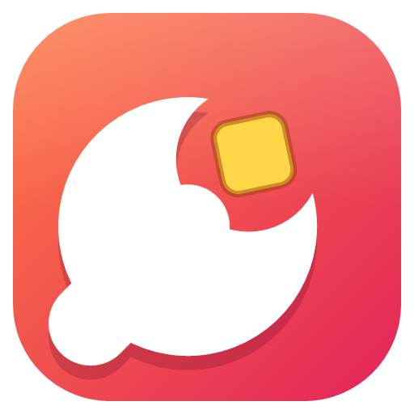

<p align="center">
  
</p>

<h1 align="center">Kıskaç</h1>

<p align="center">
  Windows ve macOS için hafif, hızlı ekran görüntüsü aracı. <b>PrtSc</b> (macOS'ta <b>⇧⌘2</b>) bas, alanı seç, üstüne çiz, kopyala.
</p>

---

Kıskaç, Lightshot benzeri bir ekran görüntüsü aracıdır. Windows'ta tek bir küçük `.exe` dosyasıdır, kurulum gerektirmez ve sistem tepsisinde sessizce çalışır. macOS'ta yerel (Swift + AppKit) bir menü çubuğu uygulamasıdır.

## Özellikler

- **PrtSc ile anında çekim:** ekran kararır, alanı sürükleyerek seçersin. Tek tıklarsan o monitörün tamamı seçilir.
- **Çoklu monitör ve yüksek DPI desteği:** farklı ölçeklerdeki monitörlerde net çekim yapar.
- **Seçimi düzenleme:** seçimi taşıyabilir, 8 tutamaçtan boyutlandırabilirsin. Boyut piksel olarak görünür.
- **Çizim araçları:** kalem, çizgi, ok, dikdörtgen, fosforlu kalem ve metin.
  - Shift'e basılıyken çizgi ve ok 45° adımlarla, dikdörtgen kare çizilir.
- **6 renk:** kalınlığı fare tekerleğiyle ayarlarsın.
- **Kopyala veya kaydet:** panoya kopyalayabilir ya da PNG, JPG veya BMP olarak kaydedebilirsin.
- **Sistem tepsisi ve otomatik başlatma:** Windows açılınca kendiliğinden başlar (tepsi menüsünden kapatılabilir).
- **Diğer kısayollar korunur:** Alt+PrtSc ve Win+PrtSc Windows'ta eskisi gibi çalışır.

## Kısayollar (Windows)

| Tuş | İşlev |
|---|---|
| `PrtSc` | Ekran görüntüsü al |
| `Ctrl+C` / `Enter` / çift tık | Panoya kopyala ve kapat |
| `Ctrl+S` | Dosyaya kaydet |
| `Ctrl+Z` | Geri al |
| `Esc` / sağ tık | İptal |
| `S` `P` `L` `A` `R` `M` `T` | Seç, Kalem, Çizgi, Ok, Dikdörtgen, Fosforlu kalem, Metin |
| Fare tekerleği | Kalem kalınlığı |

## Derleme (Windows)

Ek bir şey kurman gerekmez. Windows 10 ve 11 ile gelen .NET Framework 4.8 C# derleyicisi yeterlidir:

```powershell
powershell -ExecutionPolicy Bypass -File build.ps1
```

Çıktı `bin\Kiskac.exe` olarak oluşur. Uygulama simgesi derleme sırasında koddan ([src/Logo.cs](src/Logo.cs)) üretilir.

## macOS

macOS sürümü ayrı ve tamamen yerel bir uygulamadır ([macos/](macos/)). Apple Silicon ve Intel için evrensel derlenir. macOS 14 (Sonoma) veya üstü gerekir.

- **Menü çubuğunda çalışır:** Dock'ta görünmez. Simge açık ve koyu menü çubuğuna kendiliğinden uyar.
- **ScreenCaptureKit ile çekim:** tüm ekranlar aynı anda, her biri kendi Retina çözünürlüğünde yakalanır. Kaydedilen ve kopyalanan görüntü tam piksel çözünürlüğündedir; boyut etiketi de piksel gösterir.
- **Akıcı seçim:** ekran görüntüsü bir kez GPU katmanına verilir. Fare hareketinde yalnızca karartmadaki delik ve değişen bölge yeniden çizilir.
- **Çoklu ekran ve tam ekran uygulamalar:** her ekran kendi seçim penceresini alır, tam ekran uygulamaların üstünde de açılır.
- **İz dörtgeni:** kalınlık iki parmak kaydırmayla ayarlanır.
- **Kapatınca önceki uygulamaya döner:** kopyaladıktan hemen sonra ⌘V ile yapıştırabilirsin.

### Kısayollar (macOS)

| Tuş | İşlev |
|---|---|
| `⇧⌘2` veya `F13` | Ekran görüntüsü al (PC klavyelerindeki PrtSc tuşu macOS'ta F13 olarak gelir) |
| `⌘C` / `↩` / çift tık | Panoya kopyala ve kapat |
| `⌘S` | Dosyaya kaydet (PNG veya JPEG) |
| `⌘Z` | Geri al |
| `Esc` / sağ tık | İptal |
| `S` `P` `L` `A` `R` `M` `T` | Seç, Kalem, Çizgi, Ok, Dikdörtgen, Fosforlu kalem, Metin |
| `⇧↩` | Metinde yeni satır |

Kıskaç zaten çalışırken uygulamayı yeniden açmak (Spotlight, Finder) da ekran görüntüsü alır.

### Derleme (macOS)

Yalnızca Xcode Komut Satırı Araçları gerekir (`xcode-select --install`). Xcode projesi yoktur:

```sh
./macos/build.sh
```

Çıktı `bin/Kiskac.app` olarak oluşur. **İlk açmadan önce Uygulamalar klasörüne taşı:** ilk açılışta oturum açılınca başlatma, uygulamanın o anki konumuna kaydedilir. Uygulama simgesi derleme sırasında koddan ([macos/Sources/Logo.swift](macos/Sources/Logo.swift)) üretilir.

### Ekran kaydı izni

İlk çekimde macOS, **Sistem Ayarları › Gizlilik ve Güvenlik › Ekran ve Sistem Sesi Kaydı** iznini ister. İzni verdikten sonra Kıskaç'ı yeniden başlatman gerekebilir.

Betik uygulamayı yerel (ad-hoc) olarak imzalar. Yeniden derlediğinde imza değişir, macOS da izni yeniden isteyebilir. Bu durumda listeden Kıskaç'ı kaldırıp yeniden ekle. Sabit bir imza kullanmak için: `SIGN_IDENTITY="Apple Development: ..." ./macos/build.sh`.

## Proje yapısı

| Dosya | Görevi |
|---|---|
| `src/Program.cs` | Giriş noktası, tek örnek kontrolü |
| `src/TrayContext.cs` | Tepsi simgesi, menü, çekimi başlatma |
| `src/KeyboardHook.cs` | Sistem genelinde PrtSc yakalama (ayrı iş parçacığında) |
| `src/OverlayForm.cs` | Seçim ekranı, araç çubuğu, çizim ve kaydetme |
| `src/Shapes.cs` | Kalem, çizgi, ok, dikdörtgen, metin şekilleri |
| `src/Logo.cs` | Kodla çizilen logo |
| `macos/Sources/AppDelegate.swift` | macOS: menü çubuğu, kısayol, izinler |
| `macos/Sources/Capture.swift` | macOS: ScreenCaptureKit ile çoklu ekran çekimi |
| `macos/Sources/Overlay.swift` | macOS: seçim ekranı, araç çubuğu, kopyalama ve kaydetme |
| `macos/Sources/Shapes.swift` | macOS: çizim şekilleri |
| `macos/Sources/Logo.swift` | macOS: logo, uygulama ve menü çubuğu simgesi |

## Lisans

[MIT](LICENSE)
